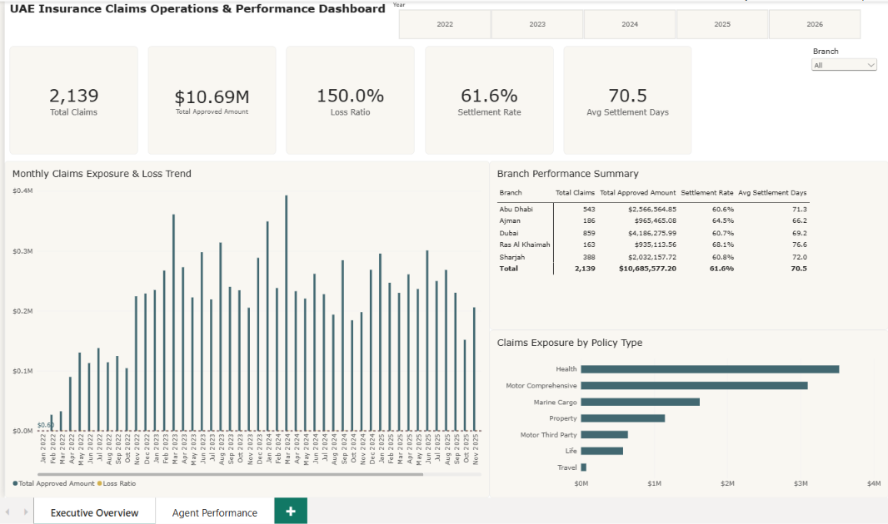

# UAE Insurance Claims Operations & Performance Dashboard

An executive-level Power BI reporting suite designed to monitor risk exposure, loss ratios, and claim processing latency across 5 regional branches in the United Arab Emirates.

---

## 📊 Executive Overview

### Key Operational Metrics
- **Total Claims Processed:** 2,139
- **Approved Payout Volume:** $10.69M
- **Portfolio Loss Ratio:** 150.0%
- **Claim Settlement Rate:** 61.6%
- **Average Settlement Duration:** 70.5 Days

---

## 🔍 Key Business Insights

1. **Category Risk Concentration:**
   - **Health** ($3.4M+) and **Motor Comprehensive** ($2.8M) represent over 65% of total gross claims payout volume.
   - Low-volume lines such as **Travel** and **Life** maintained negligible loss exposure.

2. **Branch Settlement Performance:**
   - **Dubai:** Highest claim volume (859 claims) totaling $4.18M with a 69.2-day average settlement speed.
   - **Ras Al Khaimah:** Longest cycle latency averaging 76.6 days with a 68.1% settlement completion rate.
   - **Ajman & Abu Dhabi:** Steady cycle turnaround times between 66.2 and 71.3 days.

3. **Loss Trend Seasonality:**
   - Multi-year trend analysis highlights critical seasonal peaks in exposure, allowing underwriting teams to recalibrate premium reserves before margins erode.

---

## ⚙️ Technical Architecture & Modeling

- **Data Model:** Clean Star Schema linking `Fact_Insurance_Claims` to dimension tables (`Dim_Date`, `Agents`, `Branch`).
- **ETL Processing:** Built in Power Query (M) with automated date parsing, deduplication, unpivoting, and type safety.
- **DAX Measures:** 
  - Dynamic Time-Intelligence (YTD/YoY pacing)
  - Custom KPI calculations: `Loss Ratio %`, `Settlement Rate %`, `Avg Settlement Days`
- **Canvas Design:** 16:9 standard enterprise layout with corporate palette (#F4F5F7), custom cards, and interactive slicers.# UAE-Insurance-Claims-Dashboard
Executive Power BI dashboard analyzing 2,139 claims and $10.69M in exposure across 5 UAE branches with DAX time intelligence and star-schema modeling.
